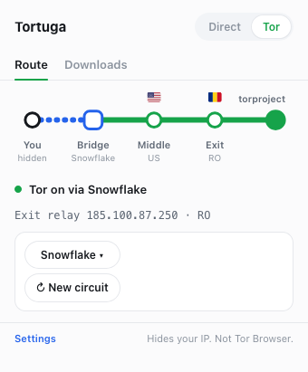
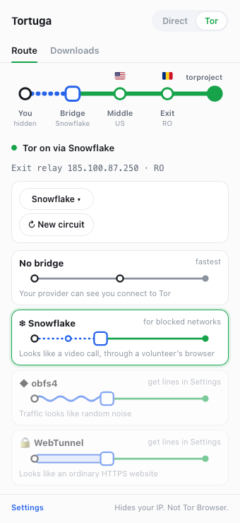
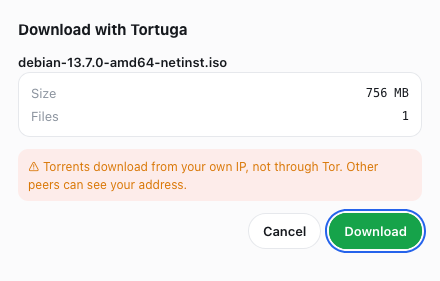
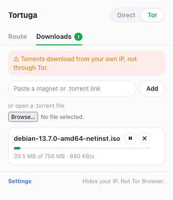

<div align="center">


# Tortuga

**Tor routing and torrent downloads, right in the browser you already use.**

Flip one switch and your browser goes through Tor. Each site gets its own circuit, and you can see the route it takes. Torrent links download in the same popup.

[](https://github.com/legenki/tortuga/releases/latest)
[](https://github.com/legenki/tortuga/actions/workflows/release.yml)




</div>

## Why Tortuga?

Tor hides your IP address from the sites you visit and hides the sites you visit from your network. The usual way to get it is Tor Browser, a separate browser. Tortuga brings the routing part into Chrome or Firefox, with a small helper program that runs Tor on your computer.

It's for when you want your IP hidden or need to reach a blocked site, but don't want to switch browsers to do it.

| | Tortuga | Tor Browser |
|---|---|---|
| Hides your IP from sites | ✓ | ✓ |
| Opens `.onion` sites | ✓ | ✓ |
| Gets past blocks with bridges | ✓ | ✓ |
| A separate circuit for each site | ✓ in Firefox | ✓ |
| Makes you look like every other user | – | ✓ |
| Works in your own browser, with your extensions | ✓ | – |

**Tortuga is not Tor Browser.** Your browser still looks like your browser: its fingerprint, extensions and settings can tell sites apart from other people. If your safety depends on staying anonymous, use [Tor Browser](https://www.torproject.org/download/).

## What you get

- **One switch.** `Direct` or `Tor`. Tortuga shows progress while Tor connects and says plainly when it can't.
- **A map of the route.** Each site's path is drawn like a metro line: you, the bridge or guard, the middle relay, the exit and the site, with country flags. **New circuit** gives the current site a fresh path.
- **One circuit per site.** In Firefox each site gets its own path through Tor, so one site's exit doesn't see your traffic to another.
- **Bridges for blocked networks.** Snowflake works out of the box. obfs4 and WebTunnel lines can be fetched from the Tor Project on the settings page in one click, or pasted in. Each bridge is drawn as its own kind of line, so you can see which one you're on.
- **No leaks when Tor stops.** If the helper or Tor stops, requests are blocked instead of being sent from your real IP, until you press **Restart** or switch to `Direct`.
- **Torrent downloads.** Click a magnet or `.torrent` link on any page, right-click one, or paste it in the popup. Tortuga shows the name and size and asks before downloading. Downloads can be paused, resumed and removed, with or without their files.
- **Light or dark.** Follows your system, or pick one on the settings page.
- **No account, no analytics.**

<div align="center">


</div>

## Install

Tortuga has two parts: the **helper**, a small program that runs Tor and downloads torrents, and the **extension**, which controls it from the browser.

**1. Install the helper** from the [latest release](https://github.com/legenki/tortuga/releases/latest):

| System | File | How |
|---|---|---|
| **macOS** (Apple silicon and Intel) | `Tortuga-Helper-<version>-macos.pkg` | Open it and follow the installer. It installs for your user only and doesn't ask for an admin password. |
| **Debian, Ubuntu** (x86-64) | `tortuga-helper_<version>_amd64.deb` | `sudo apt install ./tortuga-helper_<version>_amd64.deb` |
| **Debian, Ubuntu** (ARM64) | `tortuga-helper_<version>_arm64.deb` | `sudo apt install ./tortuga-helper_<version>_arm64.deb` |
| **Windows** (x86-64) | `Tortuga-Helper-<version>-windows-x86_64.zip` | Unzip, then run `powershell -ExecutionPolicy Bypass -File install.ps1`. No admin rights needed. |

**2. Add the extension.** Store listings for Chrome and Firefox are on the way. Until then:

- **Chrome:** download `tortuga-chrome-<version>-unpacked.zip` from the same release and unzip it into a folder you'll keep. Open `chrome://extensions`, turn on **Developer mode**, choose **Load unpacked** and select that folder. Don't use `tortuga-chrome-<version>.zip` for this: it's the store package, and loaded unpacked it gets an extension ID the helper refuses.
- **Firefox:** build it yourself as described below.

| Browser | Needs |
|---|---|
| **Firefox** | Firefox 142+ (desktop) |
| **Chrome** and Chromium browsers | Chrome 120+ |

## Get started

1. Click the Tortuga icon and switch from `Direct` to `Tor`.
2. Wait a few seconds while Tor connects. The status line turns green.
3. Open any site. The **Route** tab shows the path your traffic takes to it.

If Tor can't connect, your network may be blocking it. Open the bridge menu under the route and pick **Snowflake**. If that doesn't help either, open **Settings**, choose **Get obfs4 lines** or **Get WebTunnel lines**, and pick that bridge.

To download a torrent, just click its link. Files are saved in `Downloads/Tortuga`.

## Good to know

**Torrents don't go through Tor.** The Tor Project asks people not to use BitTorrent over Tor, because it slows the network for everyone and can leak your IP anyway. Tortuga downloads torrents directly, from your own IP, and says so every time. Other people in the swarm can see your address.

**Chrome and Firefox work differently:**

| | Firefox | Chrome |
|---|---|---|
| What goes through Tor | The whole browser | Incognito windows only |
| A separate circuit for each site | ✓ | – (one shared circuit) |
| Fingerprinting protection while Tor is on | ✓ (`resistFingerprinting`) | – |
| WebRTC can't reveal your IP | ✓ | ✓ |
| Torrent downloads | ✓ | ✓ |

In Chrome, allow Tortuga in Incognito: open `chrome://extensions`, click **Details** under Tortuga and turn on **Allow in Incognito**. The popup explains this when it's needed.

While Tor is on in Firefox, Tortuga turns on Firefox's `resistFingerprinting` and turns off WebRTC for the whole browser. Both go back to how they were when you switch to `Direct`.

**Uninstalling the helper:**

- **macOS:** `"$HOME/Library/Application Support/Tortuga/uninstall.sh"` (version 0.2.0 and older installed for every user: `sudo "/Library/Application Support/Tortuga/uninstall.sh"`)
- **Debian, Ubuntu:** `sudo apt remove tortuga-helper`
- **Windows:** run `uninstall.ps1` in `%LOCALAPPDATA%\Tortuga`

Your downloads are left where they are.

## Privacy

Tortuga has no account, no analytics and no server of its own. It doesn't collect or sell your data, and your settings stay in your browser. The connections it makes:

- **The Tor network.** While Tor is on, the helper connects to Tor relays, or to the bridge you picked, and your browsing goes through them.
- **bridges.torproject.org**, only when you click **Get obfs4 lines** or **Get WebTunnel lines**. It goes through Tor when Tor is on.
- **Torrent peers and trackers**, directly, only while you download or share. A finished download shares until it has uploaded one copy, then stops. A `.torrent` link is fetched by the helper, without your browser's cookies, and through Tor while Tor covers the page it was on. While Tor is on, Tortuga asks before looking up a magnet link, since that reveals your IP to the swarm.

The [privacy policy](PRIVACY.md) has the details.

## Build it yourself

You need Node.js 22 or later for the extension, and Rust (stable) and GnuPG (`gpg`) for the helper.

**The helper:**

```bash
helper/scripts/fetch-pt.sh
(cd helper && cargo build --release -p tortuga-helper)
extension/scripts/register-dev-host.sh
```

`fetch-pt.sh` downloads the bridge transports from the official Tor Expert Bundle and checks them against Tor's checksums, and the checksums against the Tor Browser Developers signing key kept in the repository. `register-dev-host.sh` installs the build for your user so the browser can start it. Run it again after each build.

**The extension:**

```bash
cd extension
npm ci
npm run build:firefox
npm run start:firefox
```

For Chrome, run `npm run build`, open `chrome://extensions`, turn on Developer mode, choose **Load unpacked** and select `extension/dist/`. Then run `extension/scripts/register-dev-host.sh <extension ID>` with the ID Chrome shows, so the helper accepts it.

| Command (in `extension/`) | What it does |
|---|---|
| `npm test` | Runs the unit tests (Vitest) |
| `npm run typecheck` | Checks the TypeScript |
| `npm run lint:firefox` | Runs Mozilla's `web-ext lint` on the Firefox build |
| `npm run package` | Builds the Chrome zip |
| `npm run package:firefox` | Builds the Firefox zip and source archive |
| `scripts/live-check/run.sh` | Tests Tor mode end to end in headless Firefox |
| `scripts/live-check/run.sh downloads` | Tests torrent downloads end to end |

`cargo test -p tortuga-helper` in `helper/` runs the helper's tests.

The extension is TypeScript and plain DOM, bundled with Vite. The helper is Rust, with [Arti](https://gitlab.torproject.org/tpo/core/arti) for Tor and [librqbit](https://github.com/ikatson/rqbit) for torrents.

```
extension/src/background/  routing, the helper connection, torrent links
extension/src/popup/       the popup, metro diagram and downloads
extension/src/options/     the settings page and bridge lines
extension/src/confirm/     the window that asks before a download
extension/src/content/     catches clicks on torrent links
helper/tortuga-helper/     the helper: Tor, SOCKS server, torrents, bridges
helper/packaging/          macOS, Debian and Windows installers
```

[RELEASE.md](RELEASE.md) covers releases, and [extension/BUILD.md](extension/BUILD.md) covers packaging the extension.

## Feedback

Found a bug or have an idea? [Open an issue](https://github.com/legenki/tortuga/issues). It helps to mention your browser, your system, your Tortuga version and which bridge you use. Please leave out bridge lines and anything that identifies you.

## Credits and license

Thanks to:

- [Arti](https://gitlab.torproject.org/tpo/core/arti), the Tor Project's Tor in Rust (MIT or Apache-2.0)
- [lyrebird](https://gitlab.torproject.org/tpo/anti-censorship/pluggable-transports/lyrebird) from the Tor Expert Bundle, for obfs4, Snowflake and WebTunnel (BSD)
- [librqbit](https://github.com/ikatson/rqbit) for torrents (Apache-2.0)
- [Twemoji](https://github.com/twitter/twemoji) for the flag artwork (CC-BY 4.0, see [`extension/public/fonts/LICENSE.md`](extension/public/fonts/LICENSE.md))
- [tldts](https://github.com/remusao/tldts) for telling sites apart (MIT)

Tortuga is not made by or affiliated with the Tor Project. "Tor" is a trademark of The Tor Project, Inc.

Tortuga is © Andy Legenki, all rights reserved. The source is public so you can read it, audit it and build it yourself. Third-party parts keep their own licenses.
